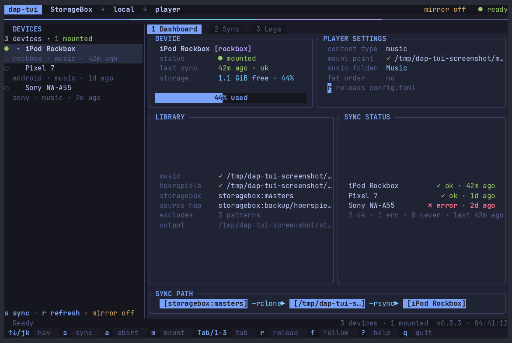
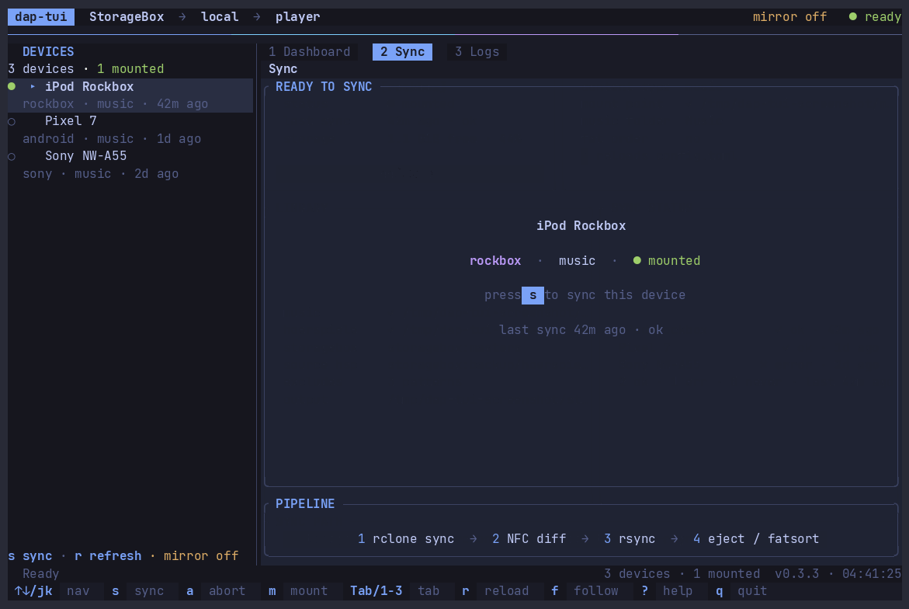

# dap-tui

[](https://github.com/ssalentin/dap-tui/actions/workflows/ci.yml)
[](LICENSE)
[](Cargo.toml)

A terminal UI for device sync of portable music players, rewritten from scratch
in Rust on top of [ratatui](https://ratatui.rs/).

It mirrors the StorageBox masters library into your local music directory, then
syncs a device profile — the same pipeline as the Python `dap-sync`, now as a
living dashboard instead of a batch CLI.



## Highlights

- **Tokyo Night** palette, rounded panels, gradient title rule, status & key
  bars.
- **Devices sidebar** — live mount status (green dot = mounted), firmware tags,
  last-sync age per device.
- **3 tabs** — Dashboard (per-player overview + settings, storage usage when
  mounted, library + sync pipeline), Sync (live step pipeline + progress
  gauge with speed/ETA, timeline of the last run), Logs (color-coded, follow
  mode, warning/error counters).
- **Responsive layout** — short terminals drop the decorative sync-path card,
  narrow cards switch to compact labels/values and ellipsize long paths
  instead of clipping them mid-word, and cards size to their own content
  instead of stretching into dead space on a tall terminal.
- **Live sync engine** — streams `rclone` and `rsync` output, parses progress
  (byte-weighted via `--info=progress2`), NFC-aware diffing for
  macOS→FAT32/Android devices, optional `fatsort` finalize for Mlove devices.
- **Abort-safe** — `a` kills the running child process group cleanly; quitting
  while a sync runs aborts it first instead of leaving it orphaned.
- **Mount-aware** — a path that exists but is not a real mount point is flagged
  and refused as a sync target, so a leftover mount directory can't silently
  receive a sync on the root filesystem.
- Reads the existing `~/.config/dap-sync/config.toml` (compatible with
  `dap-sync`), persists last-sync state to `~/.local/share/dap-sync/sync-state.toml`.

## Install / run

```bash
cargo build --release
./target/release/dap-tui            # uses ~/.config/dap-sync/config.toml
./target/release/dap-tui --config /path/to/config.toml
./target/release/dap-tui --skip-mirror   # skip the StorageBox → local mirror step

# install/update the `dap-tui` command (~/.cargo/bin) with the new build
cargo install --path . --force
dap-tui
```

## Keybindings

| Key          | Action                       |
| ------------ | ---------------------------- |
| `↑`/`↓` `j`/`k` | move selection             |
| `s` / `Enter`| sync selected device         |
| `a`          | abort running sync           |
| `m`          | mount / unmount device (udisks2, no sudo) |
| `Tab` / `1-3`| switch tab                   |
| `r`          | reload config + refresh mounts |
| `f`          | toggle log follow            |
| `u` / `d`    | scroll logs                  |
| `x`          | clear logs                   |
| `?` / `h`    | help overlay                 |
| `q` / `Esc`  | quit                         |

## Manual

### Syncing a device



Select a device in the **DEVICES** sidebar with `↑`/`↓` or `j`/`k`, then press
`s` or `Enter`. The Sync tab switches to a live step timeline — Mirror
StorageBox → Sync *device* → Finalize FAT (Mlove devices only) — with a
progress gauge showing percent complete, bytes transferred, speed and ETA. A
cloud mirror shows a "Scanning remote" phase first while rclone lists the
whole remote (`--check-first`) before any bytes move, so the percentage is a
true overall figure instead of a growing-total guess. Once a sync finishes,
the step timeline and its ✓/✗ outcomes stay on screen — press `s` again to
rerun.

### Mounting and unmounting

Press `m` on the selected device to mount or unmount it via **udisks2** — no
`sudo` required. Starting a sync on an unmounted device mounts it
automatically first; if that fails, dap-tui tells you to connect the device
and mount it (`m`), then retry. Mount state and the sync target are always
checked against the real kernel mount table (`/proc/self/mountinfo`), never
just whether the configured directory happens to exist, so a leftover empty
mount folder from an earlier unclean eject is never mistaken for a connected
device.

### Aborting

Press `a` while a sync is running to abort it: the whole child process group
(rclone, rsync, podkit, and anything they in turn spawned) is signalled to
terminate, escalating to a hard kill if it hasn't stopped within a couple of
seconds. Quitting (`q` / `Esc`) during an active sync runs the same abort
first, so closing dap-tui can never leave a sync running in the background.

### Following logs

Switch to the Logs tab (`3`, or `Tab`/`Shift-Tab`) for color-coded output —
info, file transfers, warnings and errors are each styled distinctly, with a
running warning/error count in the header. Press `f` to toggle follow mode
(auto-scroll to the newest line) on and off, `u`/`d` to scroll manually, and
`x` to clear the buffer.

## Configuration

`dap-tui` reads the standard `dap-sync` config format:

```toml
[paths]
local_music_dir = "~/Music"
local_hoerspiele_dir = "~/hoerspiele"

[storagebox]
source = "storagebox:masters"
exclude = ["/Music/**", ".DS_Store", ".localized"]

[[devices]]
name = "iPod Rockbox"
firmware = "rockbox"
mount_point = "/media/sebastian/IPOD"
music_folder = "Music"
```

Firmware types: `apple` (podkit command), `rockbox`, `android`, `sony`
(rsync to a mounted volume), `mlove` (rsync + `fatsort`). Devices with
`content_type = "hoerspiele"` sync against the hoerspiele library.

## How the sync pipeline works

1. **Mirror** — `rclone sync` (or local `rsync`) pulls the StorageBox source
   into the local library. rclone runs with `--check-first`, so the remote
   listing completes before transfers start: the gauge then shows a true
   overall percentage instead of the growing-total estimate, and the listing
   phase is displayed as `Scanning remote · N items listed`.
2. **Diff** — the device is scanned and compared to the source with
   NFC-normalised paths, size, and 2-second-rounded mtimes (FAT32 friendly).
3. **Sync** — stale files are removed first, then `rsync --files-from` copies
   only what changed, with live per-file progress.
4. **Finalize** (mlove) — unmounts the volume and runs `fatsort` via
   `sudo -n` to keep FAT directory order stable. If passwordless sudo is not
   available the step is reported as a warning and the commands are printed.

## Mounting

Devices are mounted/unmounted without sudo via **udisks2**:
`m` in the TUI mounts/unmounts the selected device, and a sync automatically
mounts the target first (resolved by mount-point label via `lsblk`, matched
case-insensitively). Only the mlove `fatsort` step needs root (raw block
device).

Mount status and sync targets are validated against the kernel mount table
(`/proc/self/mountinfo`), not just directory existence. The configured
`mount_point` is a hint: if udisks mounted the volume at a suffixed sibling
because the configured directory already existed (e.g. `IPOD` → `IPOD1`), or
under a different parent than configured (e.g. an automount service using
`/run/media/...` while the config says `/media/...`), dap-tui follows the
actual mount and uses it as the sync destination. If the path exists but is
not a mount at all, syncing into it is refused rather than writing the
library onto the root filesystem.

## Development

```bash
cargo test      # parser + config tests
cargo run
```
